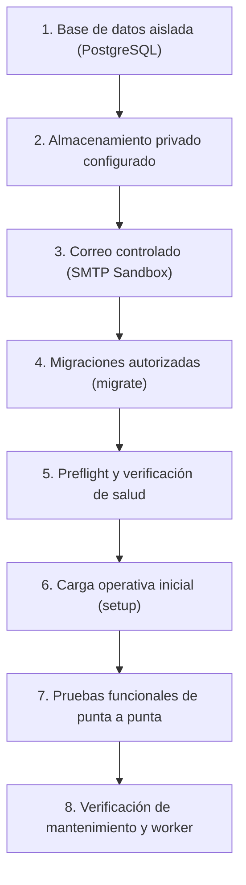
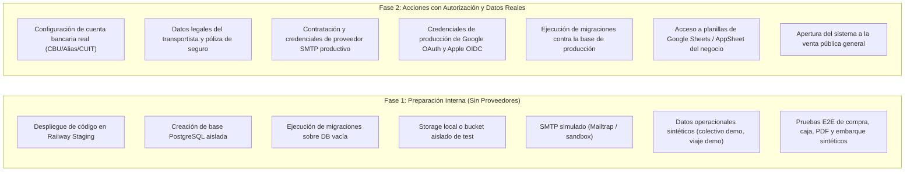

# Plan de Despliegue en Staging y Datos Pendientes de Sandro

## Resumen Ejecutivo

Este documento define el plan técnico y operativo para preparar, desplegar y validar un entorno de **Staging** para la plataforma **SC Viajes**, previo a cualquier consideración de puesta en producción.

El proyecto cuenta con una arquitectura de monolito modular en Django (`sslviajes`), con dominio probado en SQLite y PostgreSQL, panel administrativo propio, motor de generación de pasajes en PDF con numeración secuencial protegida, módulos de caja diaria, outbox de notificaciones transaccionales y mecanismos de verificación previa (`production_preflight`).

El objetivo de este plan es ordenar la secuencia de activación en staging, documentar con precisión las variables y configuraciones requeridas distinguiendo roles y responsabilidades, aislar los datos comerciales y legales pendientes de confirmación por parte de Sandro, clarificar las decisiones de negocio que continúan abiertas frente a las ya resueltas en la arquitectura canónica, y garantizar que no se ejecuten migraciones ni accesos sobre bases de producción sin autorización explícita.

---

## 1. Infraestructura ya Implementada y Qué Falta Configurar

### 1.1. Infraestructura Implementada en la Base de Código

1. **Monolito Modular Django (`sslviajes`)**:
   - Módulos desacoplados: `core`, `operations`, `sales`, `payments`, `tickets`, `customers`, `notifications`, `cash_register`, `panel`.
   - Django Admin 100 % deshabilitado; interfaz administrativa y operativa totalmente personalizada bajo `/panel/`.
   - Horarios e interfaces en horario de Argentina (`America/Argentina/Buenos_Aires`) y español argentino.
   - Recursos estáticos locales gestionados mediante WhiteNoise con compresión y manifest (`CompressedManifestStaticFilesStorage`); cero dependencias de CDNs externos.

2. **Capa de Persistencia y Concurrencia**:
   - Configuración desacoplada mediante `dj_database_url`.
   - Soporte verificado para PostgreSQL en producción y CI, con bloqueos transaccionales ordenados (`select_for_update`), advisory locks de sesión para mantenimiento, y restricciones condicionales únicas (`sales_active_trip_seat_unique`, unicidad de embarque activo en `BoardingRecord`, unicidad de caja abierta por vendedor).
   - Compatibilidad completa con SQLite para suites de pruebas locales y desarrollo efímero.

3. **Almacenamiento Privado de Archivos Sensibles**:
   - Módulo unificado `core.private_storage` con selector de backend (`filesystem` local frente a `s3` compatible vía `django-storages[s3]`).
   - Alcances separados para pasajes PDF (`TICKETS_STORAGE_ROOT`) y comprobantes de transferencias (`PROTECTED_MEDIA_ROOT`).
   - Política de URLs públicas denegada (`base_url=None`, método `url()` bloqueado); todas las descargas son intermediadas por endpoints de Django con validación de tokens hash o roles internos (`Administrador`, `Vendedor`).

4. **Motor de Pasajes Oficiales y Verificación**:
   - Generador ReportLab y `qrcode` en Python puro (sin dependencias C/nativas frágiles).
   - Plantilla oficial aprobada de 1 página con dos talones (empresa y pasajero), línea de corte punteada, condiciones generales reproducidas textualmente y canal de atención comercial centralizado.
   - Numeración secuencial persistente `TicketSequence` con bloqueo transaccional (`AAA-000000001` en adelante).
   - Códigos QR visuales eliminados de la impresión; persistencia de hashes criptográficos (SHA-256) para verificación de embarque por teclado o lector en `/panel/embarques/`.

5. **Caja Diaria y Cobros**:
   - Módulo `cash_register` con sesiones individuales de apertura, arqueo y cierre por vendedor.
   - Vinculación obligatoria 1 a 1 entre pagos en efectivo `APPROVED` y movimientos inmutables de caja (`CashMovement`).
   - Reportes de caja por fecha operativa argentina con protección de fórmulas en exportaciones CSV con UTF-8 BOM.

6. **Notificaciones y Outbox Transaccional**:
   - Aplicación `notifications` con tabla outbox durable (`TransactionalNotification`) separada del envío de pasajes.
   - Creación de envíos mediante hooks `transaction.on_commit` y procesamiento desacoplado con leases para tolerancia a caídas.

7. **Procesos de Mantenimiento Operativo**:
   - Comando `run_operational_maintenance` para ejecución por lotes de expiraciones de reservas retenidas, pagos vencidos, reconciliación de pasajes y outbox.
   - Comando `run_maintenance_worker` para proceso residente o ejecución única (`--once`), con exclusión mutua mediante advisory lock de sesión en PostgreSQL.
   - `Procfile` configurado para procesos separados `web` y `worker`.

8. **Preparación Previa y Diagnóstico**:
   - Endpoints HTTP `/health/live/` (liveness sin dependencias) y `/health/ready/` (readiness con chequeo de conectividad a PostgreSQL y migraciones).
   - Comando CLI `python manage.py production_preflight` con validaciones de entorno, variables críticas, estado de migraciones, configuración de storage, SMTP, proxies y backups.
   - Módulo `core.backup` con herramientas para preparación, creación y verificación de volcados PostgreSQL con `pg_dump`/`pg_restore`, manifests JSON y checksums SHA-256.

### 1.2. Qué Falta Configurar para el Entorno de Staging

Para que el entorno de staging esté plenamente operativo se debe configurar fuera del repositorio:

1. **Instancia de Base de Datos PostgreSQL Aislada**:
   - Crear una base de datos PostgreSQL exclusiva para staging en Railway.
   - **Regla estricta**: No compartir base con desarrollo ni con producción.

2. **Bucket S3-Compatible Privado para Staging**:
   - Provisionar un bucket de pruebas (en Cloudflare R2, AWS S3 u otro proveedor compatible) o definir un volumen de almacenamiento persistente aislado si se opta por `filesystem` en staging.
   - Configurar credenciales privadas con permisos restringidos de lectura y escritura exclusivamente para este bucket.

3. **Buzón o Servidor SMTP Controlado**:
   - Configurar un servicio SMTP de prueba (por ejemplo, Mailtrap, Mailgun Sandbox o un buzón de captura interna) para validar el envío real de correos de pasajes e invitaciones sin riesgo de despachar mensajes a clientes o pasajeros reales.

4. **Dominio Público HTTPS y Orígenes Confiables**:
   - Asignar una URL canónica HTTPS para staging.
   - Declarar dicha URL en `ALLOWED_HOSTS`, `CSRF_TRUSTED_ORIGINS` y `PUBLIC_BASE_URL`.

5. **Definición Operativa del Worker de Mantenimiento**:
   - Determinar si en staging el mantenimiento se ejecutará como un servicio secundario permanente en Railway (`worker: python manage.py run_maintenance_worker`) o a través de un cron periódico efímero con `--once`.

---

## 2. Variables Requeridas por Entorno

A continuación se listan las variables de entorno necesarias para operar el sistema en sus distintas áreas funcionales, abarcando `settings`, `.env.example` y los chequeos de `production_preflight`. Cada variable se detalla con su nombre exacto, finalidad operativa y rol responsable de proveerla o definirla. **No se incluyen contraseñas, secretos, números de teléfono ni valores o defaults concretos en este documento.**

### 2.1. Núcleo, Seguridad y Plataforma (Django y Preflight)

| Variable | Finalidad / Uso en el Sistema | Responsable |
| :--- | :--- | :--- |
| `SECRET_KEY` | Clave criptográfica para firmas de sesión, cookies CSRF y tokens internos del framework. | DevOps / Infraestructura |
| `DEBUG` | Control del modo de depuración de Django (debe estar desactivado en staging y producción). | DevOps / Coordinador Técnico |
| `ALLOWED_HOSTS` | Lista de nombres de host y dominios autorizados a recibir peticiones HTTP. | DevOps / Infraestructura |
| `CSRF_TRUSTED_ORIGINS` | Lista de orígenes HTTPS completos confiables para la validación CSRF en peticiones POST. | DevOps / Infraestructura |
| `PUBLIC_BASE_URL` | URL canónica HTTPS utilizada para construir enlaces absolutos en correos, invitaciones y pasajes. | DevOps / Infraestructura |
| `DATABASE_URL` | URI de conexión a la base de datos PostgreSQL del entorno correspondiente. | DevOps / Infraestructura |
| `SECURE_HSTS_SECONDS` | Duración en segundos de la cabecera HSTS para forzar conexiones seguras vía HTTPS. | DevOps / Seguridad |
| `SECURE_HSTS_INCLUDE_SUBDOMAINS` | Habilitación de la política HSTS para todos los subdominios del proyecto. | DevOps / Seguridad |
| `SECURE_HSTS_PRELOAD` | Bandera de autorización para inclusión en la lista de precarga HSTS de los navegadores. | DevOps / Seguridad |
| `LOG_FORMAT` | Formato de serialización de logs de la aplicación (texto estructurado o JSON). | DevOps / Infraestructura |

### 2.2. Almacenamiento Privado de Documentos (Storage Privado)

| Variable | Finalidad / Uso en el Sistema | Responsable |
| :--- | :--- | :--- |
| `PRIVATE_STORAGE_BACKEND` | Selector del motor de almacenamiento para pasajes y comprobantes (`filesystem` o `s3`). | DevOps / Infraestructura |
| `PRIVATE_STORAGE_S3_BUCKET` | Nombre del bucket privado S3-compatible asignado al entorno. | DevOps / Proveedor Cloud |
| `PRIVATE_STORAGE_S3_ENDPOINT_URL` | URL del endpoint de la API S3 del proveedor cloud contratado. | DevOps / Proveedor Cloud |
| `PRIVATE_STORAGE_S3_REGION_NAME` | Región geográfica asignada al bucket de almacenamiento privado. | DevOps / Proveedor Cloud |
| `PRIVATE_STORAGE_S3_ACCESS_KEY_ID` | Identificador de clave de acceso al bucket de almacenamiento privado. | DevOps / Proveedor Cloud |
| `PRIVATE_STORAGE_S3_SECRET_ACCESS_KEY` | Clave secreta para autenticación en la API del bucket privado. | DevOps / Proveedor Cloud |
| `PRIVATE_STORAGE_S3_QUERYSTRING_EXPIRE` | Tiempo de expiración en segundos de firmas temporales si se consultan internamente. | DevOps / Configuración |
| `TICKETS_STORAGE_ROOT` | Ruta absoluta al directorio local para pasajes PDF cuando se usa backend filesystem. | DevOps / Infraestructura |
| `PROTECTED_MEDIA_ROOT` | Ruta absoluta al directorio local para comprobantes de pago cuando se usa backend filesystem. | DevOps / Infraestructura |
| `MEDIA_ROOT` | Ruta absoluta al directorio local de almacenamiento para medios generales. | DevOps / Infraestructura |

### 2.3. Correo Transaccional (SMTP)

| Variable | Finalidad / Uso en el Sistema | Responsable |
| :--- | :--- | :--- |
| `EMAIL_BACKEND` | Clase del backend de correo utilizada por Django para el envío de mensajes. | DevOps / Configuración |
| `EMAIL_HOST` | Nombre de host o dirección del servidor SMTP transaccional. | DevOps / Proveedor SMTP |
| `EMAIL_PORT` | Puerto de conexión de red del servidor SMTP. | DevOps / Proveedor SMTP |
| `EMAIL_HOST_USER` | Nombre de usuario o credencial de acceso al servicio SMTP. | DevOps / Proveedor SMTP |
| `EMAIL_HOST_PASSWORD` | Contraseña o token de autenticación en el servicio SMTP. | DevOps / Proveedor SMTP |
| `EMAIL_USE_TLS` | Habilitación de cifrado STARTTLS para la conexión SMTP (mutuamente excluyente con SSL). | DevOps / Proveedor SMTP |
| `EMAIL_USE_SSL` | Habilitación de cifrado SSL implícito para la conexión SMTP (mutuamente excluyente con TLS). | DevOps / Proveedor SMTP |
| `EMAIL_TIMEOUT` | Tiempo límite de espera en segundos para la comunicación con el servidor SMTP. | DevOps / Configuración |
| `DEFAULT_FROM_EMAIL` | Dirección de correo de remitente para comunicaciones a pasajeros y emisión de pasajes. | Sandro / Comercial |
| `SERVER_EMAIL` | Dirección de remitente utilizada para el despacho de alertas técnicas internas. | DevOps / Soporte |
| `EMAIL_REPLY_TO` | Dirección de respuesta a la cual se dirigen los correos que responden los clientes. | Sandro / Atención al Cliente |

### 2.4. Configuración Bancaria y Ventanas de Pago

| Variable | Finalidad / Uso en el Sistema | Responsable |
| :--- | :--- | :--- |
| `BANK_TRANSFER_ACCOUNT_HOLDER` | Nombre o razón social del titular de la cuenta bancaria de recaudación. | Sandro (Titular Comercial) |
| `BANK_TRANSFER_ALIAS` | Alias bancario oficial de la cuenta receptora de transferencias. | Sandro (Titular Comercial) |
| `BANK_TRANSFER_CVU` | Clave Bancaria Uniforme (CBU) o Clave Virtual Uniforme (CVU) de 22 dígitos numéricos. | Sandro (Titular Comercial) |
| `BANK_TRANSFER_CUIT` | CUIT tributario asociado al titular de la cuenta bancaria de recaudación. | Sandro (Titular Comercial) |
| `BANK_TRANSFER_ENTITY` | Nombre de la entidad bancaria o billetera virtual receptora de las transferencias. | Sandro (Titular Comercial) |
| `PAYMENTS_PROOF_WINDOW_MINUTES` | Plazo en minutos otorgado al comprador para transferir y adjuntar su comprobante de pago. | Sandro / Operaciones |
| `PAYMENTS_REVIEW_WINDOW_HOURS` | Plazo en horas para la revisión y aprobación/rechazo manual de transferencias en panel. | Sandro / Operaciones |
| `PAYMENTS_MAX_VOUCHER_SIZE_BYTES` | Tamaño máximo en bytes permitido para los archivos de comprobante subidos por clientes. | DevOps / Configuración |

### 2.5. Datos Fiscales, Legales y Operativos del Pasaje (PDF y Transporte)

| Variable | Finalidad / Uso en el Sistema | Responsable |
| :--- | :--- | :--- |
| `TICKETS_AGENCY_NAME` | Nombre comercial de la agencia emisora y comercializadora de los pasajes. | Sandro / Comercial |
| `TICKETS_CARRIER_NAME` | Denominación comercial o nombre de fantasía de la empresa transportista autorizada. | Sandro / Transportista |
| `TICKETS_CARRIER_LEGAL_NAME` | Razón social formalmente inscripta de la empresa transportista titular del servicio. | Sandro / Transportista |
| `TICKETS_CARRIER_CUIT` | CUIT tributario oficial de la empresa transportista. | Sandro / Transportista |
| `TICKETS_CARRIER_VAT_CONDITION` | Condición tributaria formal frente al IVA de la empresa transportista. | Sandro / Transportista |
| `TICKETS_CARRIER_ACTIVITY_START` | Fecha oficial registrada de inicio de actividades comerciales del transportista. | Sandro / Transportista |
| `TICKETS_CARRIER_IIBB` | Número de inscripción tributaria en Ingresos Brutos de la empresa transportista. | Sandro / Transportista |
| `TICKETS_INSURER_NAME` | Nombre de la compañía de seguros que provee la cobertura a vehículos y pasajeros. | Sandro / Aseguradora |
| `TICKETS_INSURANCE_POLICY_REF` | Número de póliza o certificado de cobertura de seguro obligatorio de transporte. | Sandro / Aseguradora |
| `TICKETS_SERVICE_QUALITY_DISPLAY` | Nivel o categoría homologada del servicio a bordo para impresión en el documento. | Sandro / Operaciones |
| `TICKETS_PLATFORM_ANNOUNCEMENT` | Texto reglamentario o aviso de presentación en plataforma impreso para los pasajeros. | Sandro / Operaciones |
| `TICKETS_CONTACT_WHATSAPP` | Línea telefónica centralizada de atención al cliente para impresión oficial en pasajes. | Sandro / Comercial |
| `TICKETS_VERIFICATION_BASE_URL` | URL base utilizada para construir enlaces de verificación y consulta de pasajes. | DevOps / Infraestructura |
| `TICKETS_RATE_LIMIT_PER_MINUTE` | Límite de peticiones por minuto permitidas para consultas del endpoint de verificación. | DevOps / Configuración |

### 2.6. Identidad de Clientes (Google OAuth y Apple OIDC)

| Variable | Finalidad / Uso en el Sistema | Responsable |
| :--- | :--- | :--- |
| `GOOGLE_OAUTH_CLIENT_ID` | Identificador de cliente para integración de autenticación social con Google. | Sandro / DevOps |
| `GOOGLE_OAUTH_CLIENT_SECRET` | Secreto de cliente para la autenticación social mediante Google OAuth. | Sandro / DevOps |
| `GOOGLE_OAUTH_SIMULATION_ENABLED` | Permite modo de simulación de Google OAuth en suites de prueba y desarrollo local. | DevOps / Configuración |
| `APPLE_OIDC_CLIENT_ID` | Services ID configurado en Apple Developer para el inicio de sesión con Apple. | Sandro / DevOps |
| `APPLE_OIDC_TEAM_ID` | Team ID asociado a la cuenta empresarial en Apple Developer. | Sandro / DevOps |
| `APPLE_OIDC_KEY_ID` | Identificador de la clave privada generada en la consola de Apple Developer. | Sandro / DevOps |
| `APPLE_OIDC_PRIVATE_KEY` | Clave privada en formato PEM para la firma criptográfica de peticiones a Apple. | Sandro / DevOps |
| `APPLE_OIDC_ENABLED` | Bandera de activación global del mecanismo de autenticación con Apple OIDC. | DevOps / Comercial |
| `APPLE_OIDC_SIMULATION_ENABLED` | Permite modo de simulación de Apple OIDC en suites de prueba y desarrollo local. | DevOps / Configuración |
| `APPLE_OIDC_AUTHORIZATION_URL` | Endpoint de autorización OAuth del proveedor Apple. | DevOps / Configuración |
| `APPLE_OIDC_TOKEN_URL` | Endpoint de intercambio de tokens criptográficos de Apple. | DevOps / Configuración |
| `APPLE_OIDC_JWKS_URL` | URL de publicación del conjunto de claves públicas JWKS de Apple. | DevOps / Configuración |
| `APPLE_OIDC_ISSUER` | Emisor institucional esperado en la verificación de tokens de identidad de Apple. | DevOps / Configuración |
| `APPLE_OIDC_JWKS_CACHE_SECONDS` | Tiempo de retención en memoria para la caché de claves JWKS de Apple. | DevOps / Configuración |
| `APPLE_OIDC_STATE_TTL_SECONDS` | Tiempo de vida del estado transaccional para flujos de autenticación Apple OIDC. | DevOps / Configuración |
| `CUSTOMERS_CLAIM_TOKEN_HOURS` | Plazo en horas de validez para enlaces de reclamo de reservas emitidas como invitado. | DevOps / Configuración |

### 2.7. Worker de Mantenimiento y Tareas Operacionales

| Variable | Finalidad / Uso en el Sistema | Responsable |
| :--- | :--- | :--- |
| `MAINTENANCE_WORKER_ENABLED` | Habilitación general para la ejecución del proceso worker de mantenimiento. | DevOps / Configuración |
| `MAINTENANCE_WORKER_MODE` | Modo operativo del worker (proceso permanente `resident` o ejecución única `cron`). | DevOps / Arquitectura |
| `MAINTENANCE_WORKER_INTERVAL_SECONDS` | Intervalo base de espera en segundos entre ciclos sucesivos de mantenimiento. | DevOps / Configuración |
| `MAINTENANCE_WORKER_JITTER_SECONDS` | Variación aleatoria en segundos entre ciclos para prevenir sincronizaciones periódicas. | DevOps / Configuración |
| `MAINTENANCE_WORKER_MAX_CYCLE_SECONDS` | Tiempo máximo de ejecución permitido por ciclo individual de mantenimiento. | DevOps / Configuración |
| `MAINTENANCE_WORKER_LOCK_WAIT_SECONDS` | Tiempo máximo de espera para obtener el advisory lock de sesión en PostgreSQL. | DevOps / Configuración |
| `OPERATIONAL_MAINTENANCE_MAX_LIMIT` | Límite máximo de elementos procesados por cada tarea individual en una corrida. | DevOps / Configuración |
| `OPERATIONAL_MAINTENANCE_MAX_SECONDS` | Tiempo límite de ejecución del comando de mantenimiento operacional por lotes. | DevOps / Configuración |
| `OPERATIONAL_MAINTENANCE_LEASE_SECONDS` | Duración del bloqueo temporal (lease) de exclusión sobre tareas en procesamiento. | DevOps / Configuración |
| `OPERATIONAL_MAINTENANCE_ENABLE_EXPIRE` | Habilitación de la tarea de expiración de reservas vencidas en el mantenimiento. | DevOps / Configuración |
| `OPERATIONAL_MAINTENANCE_ENABLE_PAYMENTS` | Habilitación de la tarea de expiración de pagos vencidos en el mantenimiento. | DevOps / Configuración |
| `OPERATIONAL_MAINTENANCE_ENABLE_FULFILLMENT` | Habilitación de la tarea de reconciliación de pasajes pendientes en el mantenimiento. | DevOps / Configuración |
| `OPERATIONAL_MAINTENANCE_ENABLE_NOTIFICATIONS` | Habilitación de la tarea de despacho del outbox de notificaciones en el mantenimiento. | DevOps / Configuración |

### 2.8. Notificaciones y Outbox Transaccional

| Variable | Finalidad / Uso en el Sistema | Responsable |
| :--- | :--- | :--- |
| `TRANSACTIONAL_NOTIFICATIONS_ENABLED` | Habilitación del sistema de despacho transaccional desacoplado vía outbox. | DevOps / Operaciones |
| `NOTIFICATIONS_MAX_ATTEMPTS` | Cantidad máxima de reintentos permitidos para el despacho de una notificación. | DevOps / Configuración |
| `NOTIFICATIONS_RETRY_DELAY_SECONDS` | Demora en segundos antes de reintentar el despacho de una notificación fallida. | DevOps / Configuración |
| `NOTIFICATIONS_LEASE_SECONDS` | Duración de la exclusión transaccional temporal de un mensaje durante su envío. | DevOps / Configuración |

### 2.9. Copias de Seguridad (Backups de Base de Datos)

| Variable | Finalidad / Uso en el Sistema | Responsable |
| :--- | :--- | :--- |
| `BACKUP_OUTPUT_ROOT` | Ruta absoluta al directorio local externo al repositorio para copias de seguridad PostgreSQL. | DevOps / Infraestructura |
| `BACKUP_MINIMUM_COPIES` | Cantidad mínima de copias de seguridad a conservar en la política de rotación. | DevOps / Políticas |
| `BACKUP_RETENTION_DAYS` | Plazo en días tras los cuales una copia de seguridad es candidata a rotación. | DevOps / Políticas |
| `BACKUP_REQUIRE_ENCRYPTION` | Exigencia obligatoria de cifrado para las copias generadas mediante `pg_dump`. | DevOps / Seguridad |
| `BACKUP_ENCRYPTION_TOOL` | Ruta o ejecutable de la herramienta externa encargada de cifrar las copias de seguridad. | DevOps / Infraestructura |

### 2.10. Parámetros de Ventas y Protección Antiabuso

| Variable | Finalidad / Uso en el Sistema | Responsable |
| :--- | :--- | :--- |
| `SALES_MAX_PASSENGERS_PER_BOOKING` | Límite máximo de pasajeros permitidos en una misma compra o transacción. | DevOps / Políticas |
| `SALES_ONLINE_HOLD_MINUTES` | Plazo en minutos de retención de butacas en estado retenido para compras online. | DevOps / Políticas |
| `SALES_ONLINE_CUTOFF_MINUTES` | Plazo en minutos de antelación previo a la subida en el que cierra la venta online. | DevOps / Operaciones |
| `SALES_MANUAL_HOLD_HOURS` | Plazo en horas de retención para reservas manuales cargadas desde el panel interno. | DevOps / Operaciones |
| `SALES_MANUAL_CUTOFF_MINUTES` | Plazo en minutos de antelación previo a la subida en el que cierra la venta manual en panel. | DevOps / Operaciones |
| `ABUSE_HASH_SECRET` | Clave secreta para el cálculo de firmas HMAC en los contadores hash de antiabuso. | DevOps / Seguridad |
| `ABUSE_TRUSTED_PROXY_IPS` | Lista de direcciones IP de proxies de confianza para lectura de cabeceras de proxy inverso. | DevOps / Infraestructura |
| `ABUSE_VERIFY_LIMIT` | Límite de consultas permitidas en la ventana de verificación de pasajes. | DevOps / Configuración |
| `ABUSE_VERIFY_WINDOW_SECONDS` | Ventana temporal en segundos para el contador de consultas de verificación. | DevOps / Configuración |
| `ABUSE_TRANSFER_LIMIT` | Límite de inicios de transferencia permitidos por ventana en checkout. | DevOps / Configuración |
| `ABUSE_TRANSFER_WINDOW_SECONDS` | Ventana temporal en segundos para el control antiabuso en transferencias. | DevOps / Configuración |
| `ABUSE_CHECKOUT_LIMIT` | Límite de operaciones de checkout permitidas por ventana en el canal web. | DevOps / Configuración |
| `ABUSE_CHECKOUT_WINDOW_SECONDS` | Ventana temporal en segundos para el control antiabuso en checkout. | DevOps / Configuración |
| `ABUSE_COUNTER_RETENTION_SECONDS` | Tiempo de retención en segundos de los registros históricos de contadores en base. | DevOps / Configuración |
| `ABUSE_COUNTER_CLEANUP_LIMIT` | Límite de filas a purgar en cada ciclo de limpieza de contadores expirados. | DevOps / Configuración |
| `SITE_BRAND_NAME` | Nombre institucional público de la plataforma en cabeceras y vistas web. | Sandro / Comercial |
| `SITE_BRAND_TAGLINE` | Lema o subtítulo descriptivo del servicio en el sitio institucional. | Sandro / Comercial |
| `SITE_SUPPORT_EMAIL` | Dirección de correo de soporte técnico exhibida en la interfaz web pública. | Sandro / Soporte |
| `SITE_WHATSAPP_URL` | Enlace institucional de contacto a WhatsApp exhibido en la interfaz web pública. | Sandro / Comercial |

---

## 3. Datos Pendientes del Transportista y Póliza de Seguro

En la implementación actual del generador de pasajes PDF (`tickets/rendering/data.py`), los campos tributarios, legales y operativos del transporte figuran con el marcador provisional de texto pendiente de confirmación.

Para emitir pasajes oficiales legalmente válidos y superar la verificación formal del documento, se requiere que Sandro confirme los siguientes datos:

1. **Nombre Comercial del Transportista (`TICKETS_CARRIER_NAME`)**: Denominación comercial o nombre de fantasía que opera el servicio y figura en ambos talones del pasaje (pendiente de confirmación con Sandro).
2. **Razón Social (`TICKETS_CARRIER_LEGAL_NAME`)**: Razón social de la entidad jurídica formalmente habilitada para la explotación del servicio de transporte (pendiente de confirmación con Sandro).
3. **CUIT del Transportista (`TICKETS_CARRIER_CUIT`)**: Clave Única de Identificación Tributaria del transportista para fiscalización y facturación (pendiente de confirmación con Sandro).
4. **Condición frente al IVA (`TICKETS_CARRIER_VAT_CONDITION`)**: Estado impositivo registrado ante la autoridad fiscal (pendiente de confirmación con Sandro).
5. **Fecha de Inicio de Actividades (`TICKETS_CARRIER_ACTIVITY_START`)**: Fecha fiscal de alta registrada ante el organismo tributario (pendiente de confirmación con Sandro).
6. **Ingresos Brutos (`TICKETS_CARRIER_IIBB`)**: Número de inscripción en la jurisdicción provincial o Convenio Multilateral (pendiente de confirmación con Sandro).
7. **Compañía Aseguradora (`TICKETS_INSURER_NAME`)**: Entidad aseguradora contratada para la cobertura civil de los pasajeros transportados (pendiente de confirmación con Sandro).
8. **Número de Póliza de Seguro (`TICKETS_INSURANCE_POLICY_REF`)**: Número de póliza vigente exigible en ruta por las autoridades de fiscalización vial y transporte (pendiente de confirmación con Sandro).
9. **Categoría / Calidad del Servicio (`TICKETS_SERVICE_QUALITY_DISPLAY`)**: Denominación técnica homologada del servicio a bordo para impresión en el pasaje (pendiente de confirmación con Sandro).
10. **Aviso de Embarque en Plataforma (`TICKETS_PLATFORM_ANNOUNCEMENT`)**: Indicación operativa reglamentaria para el pasajero sobre presentación en plataforma y llamado por altavoz (pendiente de confirmación con Sandro).
11. **Línea de WhatsApp de Atención al Pasajero (`TICKETS_CONTACT_WHATSAPP`)**: Línea telefónica centralizada oficial de atención al cliente para impresión en pasajes (pendiente de confirmación con Sandro).

---

## 4. Decisiones Comerciales Consolidadas y Preguntas Realmente Abiertas

Con el propósito de evitar reiterar definiciones ya consolidadas en el código y en la documentación canónica (`docs/DECISIONS.md`, `docs/PROJECT_SPEC.md`, `docs/STATUS.md` y documentos de integración asociados), a continuación se distinguen las definiciones ya resueltas de aquellas que continúan formalmente abiertas.

### 4.1. Decisiones ya Cerradas y Confirmadas (NO preguntar nuevamente)

- **Recorridos, paradas y tramos prohibidos**: Dos recorridos definidos (Córdoba Capital ↔ San Salvador de Jujuy) con 6 paradas en cada sentido incorporando Güemes con provincia explícita, orden y permisos de subida/bajada (Córdoba, Jesús María, Güemes, Perico, Palpalá, Jujuy). Se prohíbe de forma estricta la venta de tramos dentro de una misma provincia.
- **Reventa de butacas por tramo**: Para el MVP está confirmado que una butaca asignada bloquea el viaje completo; no se revende el asiento en tramos intermedios.
- **Canales de venta y retención**:
  - Canal Online: Retención de butaca por 15 minutos en estado `HELD`. Cierre de venta exactamente 60 minutos antes del horario de subida del pasajero.
  - Canal Manual (Vendedor en Panel): Retención rápida sin vencimiento automático (`expires_at=NULL`) hasta liberación expresa por el propio vendedor creador. Cierre de venta exactamente 30 minutos antes de la subida.
- **Límites documentados de compra**: Límite máximo de 4 pasajeros por transacción, configurable en el servidor mediante `SALES_MAX_PASSENGERS_PER_BOOKING`.
- **Tarifas operativas por salida**: Cada salida programada posee una tarifa única por categoría (`CAMA` y `SEMI_CAMA`), uniforme para cualquier tramo permitido. Solo los administradores pueden modificarla antes de la salida mediante transacción auditada; la reserva congela inmutablemente el precio histórico unitario.
- **Butacas prioritarias**: Las butacas número 51 y 54 están reservadas internamente y se liberan automáticamente para venta general a las 00:00 (hora argentina) de dos días calendario antes de la salida del viaje. No existen bypasses ni tarifas especiales previas a esa liberación.
- **Menores sin butaca**: Gratuidad aplicable a menores de cinco años (0 a 4 años cumplidos) evaluados a la fecha efectiva de compra, asociados obligatoriamente a una madre acompañante con butaca propia en la misma compra. No ocupan asiento, no descuentan disponibilidad del colectivo, mantienen precio cero y no generan comisión; viajan como pasajeros gratuitos sin butaca.
- **Fecha de compra para menores**: Consolidada en el dominio (`sales/minors.py`) como la fecha y hora efectiva de creación de la reserva (`Booking.created_at` / `purchase_at`), conservándose la gratuidad en compras de ida y vuelta aunque el menor cumpla 5 años antes del viaje o del regreso.
- **Diseño del pasaje PDF**: Aprobado el formato oficial de 1 página con dos talones (empresa y pasajero), línea de corte punteada, numeración secuencial persistente `AAA-000000001` en adelante mediante el modelo `TicketSequence` con exclusión concurrente en PostgreSQL, sin códigos QR ni barras gráficos visibles impresos, con canal de contacto oficial y condiciones generales textualmente reproducidas.
- **Caja de vendedores**: Módulo `cash_register` con sesiones individuales de apertura, arqueo y cierre por vendedor. Pagos en efectivo aprobados exigen caja abierta del vendedor e impactan en movimientos inmutables.
- **Retiro del prototipo inicial**: Confirmado por el cliente que no existen datos reales a conservar en las tablas legacy de `core`.

### 4.2. Decisiones Comerciales que Continúan ABIERTAS (Requieren Definición de Sandro)

1. **Datos de la Cuenta Bancaria de Recaudación**:
   - Falta la designación formal de la cuenta bancaria o billetera virtual oficial de la empresa para recibir las transferencias de los pasajeros (Titular, CUIT, Alias, CVU/CBU y Entidad). Sin esto, las transferencias permanecen inhabilitadas y el preflight productivo emite un `FAIL`.
2. **Datos Fiscales y Legales del Transportista**:
   - Pendiente la documentación formal detallada en la [Sección 3](#3-datos-pendientes-del-transportista-y-póliza-de-seguro) para regularizar la emisión de los pasajes oficiales.
3. **Datos Personales Obligatorios de Pasajeros**:
   - Confirmar si para emitir un pasaje es obligatorio registrar de forma inexcusable fecha de nacimiento, género y nacionalidad en el checkout web público, o si basta con Nombre, Apellido y DNI/Pasaporte.
4. **Políticas de Cambio de Pasaje y Penalización**:
   - La especificación prevé que el pasajero puede solicitar un cambio hasta 5 horas antes de la subida. Falta definir el **monto o porcentaje de la penalización** económica aplicable y el procedimiento operativo de cobro del diferencial tarifario.
5. **Política ante Cancelación del Viaje por la Empresa**:
   - Definir si en caso de fuerza mayor, desperfecto de unidad o cancelación operativa se genera saldo a favor en cuenta del cliente, reprogramación automática o reintegro bancario.
6. **Política de Cambio de Titularidad / Nombre**:
   - Definir si se permite transferir un pasaje ya emitido a otra persona física y bajo qué plazo y costo administrativo.
7. **Distribución Física Real de la Flota y Butacas Inhabilitadas**:
   - Ratificar si las unidades a utilizar respetan exactamente el esquema de 60 butacas (planta alta semicama, planta baja cama) o si existen unidades con otra disposición o butacas permanentemente inhabilitadas por razones mecánicas.
8. **Horarios Habituales y Tiempos de Escala entre Viajes**:
   - Confirmar horarios de llegada estimados y si se debe incorporar un margen de preparación obligatorio entre la llegada de un colectivo y su siguiente salida programada.
9. **Requisitos de Manifiesto Reglamentario (CNRT)**:
   - Ratificar si la exportación tabular actual del manifiesto operativo satisface la totalidad de los requerimientos de inspección en terminal y ruta o si exige campos regulatorios específicos adicionales.
10. **Proveedor Definitivo para Envío de Correo Transaccional**:
    - Selección comercial del proveedor SMTP productivo para el despacho de pasajes y notificaciones.
11. **Estructura y Calidad de Planillas AppSheet / Google Sheets**:
    - Entrega del volcado o acceso de solo lectura al esquema real de planillas operativas para el diseño de la herramienta de migración previa a producción.

---

## 5. Secuencia de Despliegue y Validación en Staging

Para ejecutar una puesta en staging ordenada, controlada y sin riesgos para los datos del negocio, se debe seguir estrictamente la siguiente secuencia de pasos:



### Paso 1: Aprovisionamiento de la Base de Datos Aislada
- Crear una nueva base de datos PostgreSQL en Railway dentro del entorno exclusivo de staging.
- Extraer la URL de conexión interna e inyectarla en la variable `DATABASE_URL` del servicio staging.
- **Control de aislamiento**: Verificar que el host y la base sean completamente diferentes de cualquier base de producción o datos locales.

### Paso 2: Configuración del Almacenamiento Privado
- Asignar el bucket S3-compatible de staging y cargar las variables `PRIVATE_STORAGE_BACKEND=s3`, `PRIVATE_STORAGE_S3_BUCKET`, `PRIVATE_STORAGE_S3_ENDPOINT_URL`, etc.
- Alternativamente, si en staging se usa almacenamiento local efímero, asegurar que `PRIVATE_STORAGE_BACKEND=filesystem` y que las rutas `TICKETS_STORAGE_ROOT` y `PROTECTED_MEDIA_ROOT` apunten a directorios absolutos fuera del repositorio.

### Paso 3: Configuración del Servidor de Correo Controlado
- Configurar el backend SMTP apuntando a una cuenta de pruebas o buzón seguro (por ejemplo, Mailtrap o entorno sandbox).
- Probar que las credenciales funcionen y que ningún correo enviado desde staging pueda llegar a direcciones reales de clientes.

### Paso 4: Ejecución de Migraciones de Base de Datos Autorizadas
- Con el servicio detenido o en modo inicial, ejecutar el comando de migración de Django contra la base de staging vacía:
  ```bash
  python manage.py migrate
  ```
- Comprobar que todas las aplicaciones (`core`, `operations`, `sales`, `payments`, `tickets`, `customers`, `notifications`, `cash_register`, `panel`) apliquen sus migraciones hasta el último estado sin errores.

### Paso 5: Verificación de Preflight y Salud del Entorno
- Recopilar los archivos estáticos en el contenedor:
  ```bash
  python manage.py collectstatic --noinput
  ```
- Ejecutar la comprobación de preflight en modo JSON para diagnosticar el estado:
  ```bash
  python manage.py production_preflight --json
  ```
- Comprobar que no existan resultados en estado `FAIL`. Los únicos posibles `WARNING` deben ser advertencias controladas de staging (por ejemplo, ausencia de datos bancarios si aún no se cargaron, lo cual mantendrá bloqueadas las transferencias).
- Iniciar el servicio web y realizar una petición HTTP a los endpoints de diagnóstico:
  - `GET /health/live/` → Debe responder `HTTP 200 {"status": "ok"}`.
  - `GET /health/ready/` → Debe responder `HTTP 200 {"status": "ready"}`.

### Paso 6: Inicialización Operativa Inicial
- Ejecutar el comando idempotente de configuración de recorridos y paradas:
  ```bash
  python manage.py setup_initial_operations
  ```
- Inicializar los grupos de usuarios operativos (`Administrador` y `Vendedor`):
  ```bash
  python manage.py setup_roles
  ```
- Ingresar al panel interno (`/panel/`) con un usuario administrador creado para el entorno y dar de alta:
  - Una unidad de prueba (Colectivo con sus 60 butacas distribuidas en planta alta y baja).
  - Un viaje programado futuro entre Córdoba y San Salvador de Jujuy.
  - Las tarifas vigentes por categoría (`CAMA` y `SEMI_CAMA`).

### Paso 7: Pruebas Funcionales de Punta a Punta

Se debe recorrer el ciclo de vida completo de una operación para garantizar la integridad del sistema:

1. **Búsqueda y Retención Online (Held)**:
   - Ingresar a la web pública, buscar pasajes para la salida creada, seleccionar butacas y completar datos de pasajeros.
   - Verificar la creación de la reserva en estado `HELD` y comprobar el temporizador de 15 minutos en el resumen.
2. **Pago por Transferencia y Aprobación**:
   - Cargar un comprobante sintético (PDF o imagen de prueba) en la vista de transferencia antes de los 5 minutos.
   - Confirmar que la reserva pase a estado `UNDER_REVIEW` y que conserve las políticas de vencimiento vigentes del canal; las reservas manuales no tienen expiración automática.
   - Ingresar al panel con rol `Administrador`, revisar el comprobante en `/panel/pagos/transferencias/` y aprobar la transferencia.
3. **Cobro Manual en Efectivo y Caja del Vendedor**:
   - Iniciar sesión en el panel como `Vendedor`.
   - Abrir la sesión de caja diaria en `/panel/caja/`.
   - Crear una reserva manual rápida para un pasajero.
   - Registrar el cobro en efectivo `APPROVED`.
   - Verificar que el pago impacte automáticamente en el saldo de la caja abierta como un movimiento de ingreso.
   - Cerrar la caja con el arqueo correspondiente y verificar el reporte.
4. **Emisión de Pasajes PDF y Notificaciones**:
   - Comprobar que la confirmación económica haya creado el registro en `TicketFulfillment`.
   - Verificar que se hayan generado los archivos PDF con la plantilla oficial aprobada, con numeración correlativa inmutable (modelo `TicketSequence`).
   - Descargar el pasaje y corroborar que se respeten los dos talones, que el canal de atención comercial para impresión en pasajes sea visible y que no existan códigos QR gráficos.
   - Verificar en el buzón SMTP controlado que se haya recibido el correo agrupado con los PDFs adjuntos.
5. **Control de Embarque en Terminal**:
   - Dirigirse a `/panel/embarques/`.
   - Seleccionar el viaje y validar el embarque ingresando el código del pasaje o su token de verificación.
   - Constatar que el estado del pasajero en el manifiesto cambie a "Embarcado".
   - Probar la reversión del embarque con un usuario Administrador ingresando el motivo obligatorio.
6. **Aislamiento de Perfiles y Seguridad**:
   - Verificar que un `Vendedor` no pueda aprobar transferencias ni alterar la configuración de viajes.
   - Verificar que un usuario no autenticado no pueda acceder a ninguna URL de `/panel/` ni descargar pasajes o comprobantes sin su token seguro.

### Paso 8: Verificación de Mantenimiento Operativo y Worker
- Ejecutar el mantenimiento en modo de inspección:
  ```bash
  python manage.py run_operational_maintenance --dry-run
  ```
- Ejecutar un ciclo real del worker de mantenimiento:
  ```bash
  python manage.py run_maintenance_worker --once
  ```
- Comprobar que se adquiera y libere correctamente el `pg_try_advisory_lock` en PostgreSQL y que el resumen JSON emitido no contenga datos sensibles.

---

## 6. Criterios Verificables para Avanzar o Detenerse y Plan de Rollback

### 6.1. Criterios para Avanzar a la Siguiente Etapa

Se considerará superada la etapa de Staging únicamente si se cumplen la totalidad de las siguientes condiciones:
- El comando `production_preflight` finaliza sin ningún ítem en estado `FAIL`.
- Los endpoints `/health/live/` y `/health/ready/` devuelven código `200` de forma sostenida.
- El ciclo completo de compra, pago (transferencia y efectivo), caja, emisión de pasaje PDF, entrega por correo, manifiesto y embarque se ejecuta sin excepciones no controladas ni errores 500.
- Los archivos sensibles (pasajes y comprobantes) se almacenan estrictamente en la infraestructura privada configurada y no son accesibles públicamente mediante URLs directas del bucket.
- La numeración secuencial de pasajes (`TicketSequence`) avanza de forma estrictamente correlativa sin colisiones ni duplicados.
- Las bitácoras de auditoría (`AuditEvent` y `TicketAuditEvent`) registran adecuadamente las transacciones críticas sin filtrar información personal (PII), números de tarjetas, tokens o contraseñas.

### 6.2. Criterios de Detención Inmediata (Stop / Blockers)

Debe detenerse el proceso de despliegue y abortar la validación si se detecta cualquiera de los siguientes problemas:
- **Fallo de conectividad o de transacciones en PostgreSQL**: Incapacidad de adquirir bloqueos `select_for_update` o errores de sincronización de esquemas.
- **Fallo en migraciones**: Error de aplicación o inconsistencia en las migraciones de Django sobre la base de staging.
- **Filtración o exposición pública de archivos**: Exposición de comprobantes de pago o pasajes mediante enlaces públicos sin control de sesión o token criptográfico.
- **Envío no intencional de correos a destinatarios reales**: Cualquier configuración que despache correos transaccionales a usuarios reales durante pruebas en staging.
- **Comportamiento no atómico en pagos o emisiones**: Escenarios donde un pago quede confirmado pero no se cree el registro de fulfillment durable, o donde fallen archivos PDF dejando registros huérfanos.

### 6.3. Plan de Rollback en Staging

En caso de requerir un retroceso en el entorno de staging:

1. **Detención de Procesos**:
   - Detener de inmediato los servicios `web` y `worker` en Railway para evitar procesamiento de reservas o tareas encoladas.
2. **Reversión del Código**:
   - Revertir el despliegue al último commit o release previamente validado en el pipeline.
3. **Manejo del Esquema de Base de Datos**:
   - Si la falla fue ocasionada por una migración defectuosa, revertir la migración específica mediante `python manage.py migrate <app> <numero_migracion_anterior>`.
   - Dado que staging es un entorno de prueba aislado y **no contiene datos productivos**, ante una corrupción severa del esquema está permitido reiniciar la base de datos de staging desde cero mediante un `drop/create database` y reejecutar `migrate` limpio.
4. **Limpieza del Almacenamiento Efímero**:
   - Si existieron fallos de escritura de PDFs o comprobantes corruptos en el storage de staging, eliminar los objetos huérfanos generados durante la prueba fallida.
5. **Registro del Incidente**:
   - Documentar la causa raíz del fallo en la bitácora técnica de desarrollo antes de reintentar el despliegue.

---

## 7. AppSheet como Etapa Posterior (Sin Pasarelas)

Es fundamental mantener una separación estricta entre la puesta en marcha de la infraestructura de staging y la futura migración de datos:

1. **AppSheet / Google Sheets es el Sistema en Operación Actual**:
   - La empresa opera cotidianamente mediante planillas de Google Sheets y la aplicación móvil de AppSheet.
   - En este plan de staging **NO se implementa, programa ni ejecuta ningún script de importación** de AppSheet.
2. **Ubicación en el Cronograma**:
   - La migración de datos desde AppSheet está formalmente categorizada como la **penúltima etapa del proyecto**, a realizarse inmediatamente antes de la puesta en producción y de la activación comercial.
3. **Requisitos Previos Indispensables**:
   - Antes de desarrollar la importación, Sandro debe proveer un volcado o acceso de solo lectura al conjunto real de hojas de cálculo, con sus encabezados de columnas definitivos, formatos de fecha, tipologías de pasajeros, historial de viajes y reglas de integridad observadas en la práctica.
   - Se diseñará previamente una herramienta de validación con `--dry-run`, reporte de inconsistencias, conteos y mecanismos de deduplicación idempotentes.
4. **Pasarelas de Pago Automáticas (Mercado Pago QR / Payway)**:
   - Permanecen fuera de alcance en esta etapa.
   - Las pasarelas automáticas no se configurarán ni se conectarán hasta que la base de datos operativa esté estabilizada y la migración desde Sheets haya sido completada y auditada en el entorno de pruebas.

---

## 8. Separación entre Preparación sin Proveedores y Acciones con Autorización Específica

Para garantizar la seguridad del proyecto y el estricto cumplimiento de las directivas de desarrollo, las actividades se dividen de forma taxativa en dos fases:



### 8.1. Acciones Permitidas en Fase de Preparación (Sin Proveedores ni Costos)

- Desplegar la versión autorizada del repositorio en el entorno de Staging de Railway.
- Crear y vincular la base de datos PostgreSQL aislada de staging.
- Ejecutar `python manage.py migrate` sobre la base de pruebas.
- Ejecutar `collectstatic` y `production_preflight` con variables sintéticas de prueba.
- Configurar almacenamiento `filesystem` o bucket S3 de staging con claves de desarrollo.
- Configurar servidor SMTP ficticio o sandbox (Mailtrap o buzón seguro).
- Ejecutar comandos de inicialización operativa (`setup_initial_operations` y `setup_roles`).
- Dar de alta unidades, paradas y viajes con datos de simulación en `/panel/`.
- Realizar pruebas integrales de navegación, reserva, comprobantes sintéticos, caja y embarque.

### 8.2. Acciones que Requieren Autorización Específica y Datos Reales del Cliente

- **Cargar datos bancarios reales**: Requiere aprobación y provisión formal de Sandro.
- **Cargar datos fiscales y societarios del transportista**: Requiere documentación formal y certificados del transportista y la aseguradora.
- **Contratar proveedor SMTP comercial**: Requiere autorización de gasto y provisión de credenciales oficiales por parte del cliente.
- **Habilitar credenciales de producción de Google OAuth / Apple Developer**: Requiere gestión sobre las cuentas institucionales de la empresa.
- **Aplicar migraciones sobre la base de datos de Producción en Railway**: Estrictamente prohibido sin autorización explícita del coordinador de desarrollo y del propietario del proyecto.
- **Conectar con fuentes de datos de AppSheet / Google Sheets**: Requiere entrega formal del esquema de planillas por parte de Sandro.
- **Habilitar transacciones económicas reales o cobros por pasarelas**: Requiere que la fase de migración esté cerrada.

---

## 9. Matriz de Bloqueos Identificados y Responsables para su Resolución

Para un seguimiento transparente de las dependencias técnicas y operativas, se consolidan a continuación los bloqueos detectados en el código y en la documentación del proyecto:

| Bloqueo / Dependencia | Impacto en el Sistema | Artefacto o Acción Necesaria | Responsable |
| :--- | :--- | :--- | :--- |
| **Ausencia de datos bancarios para transferencias** | El comando `production_preflight` falla con `FAIL` y el sistema inhabilita la carga de transferencias para clientes. | Definir y cargar `BANK_TRANSFER_ACCOUNT_HOLDER`, `BANK_TRANSFER_ALIAS`, `BANK_TRANSFER_CVU`, `BANK_TRANSFER_CUIT` y `BANK_TRANSFER_ENTITY`. | **Sandro** |
| **Datos fiscales y legales del transportista pendientes** | Los pasajes PDF oficiales se emiten con la leyenda provisional de texto pendiente de confirmación. | Suministrar Razón Social, CUIT, Inicio de actividades, IIBB, Aseguradora y Póliza de transporte. | **Sandro** |
| **Falta de proveedor SMTP para correo en staging** | Las notificaciones transaccionales y la entrega agrupada de pasajes quedan en estado `FAILED`. | Aprovisionar cuenta en servicio SMTP de prueba (Mailtrap / sandbox) y cargar variables `EMAIL_*`. | **DevOps / Infraestructura** |
| **Credenciales OAuth pendientes para autenticación social** | Los botones de acceso con Google y Apple deben permanecer en modo simulación o deshabilitados. | Generar credenciales en Google Cloud Console y Apple Developer con las URLs del entorno. | **Sandro / DevOps** |
| **Estructura y calidad de planillas AppSheet desconocidas** | Imposibilidad técnica de diseñar y auditar la herramienta de migración de datos históricos. | Entregar export o acceso de solo lectura a las hojas de cálculo operativas de Google Sheets. | **Sandro** |
| **Políticas de penalización y cambios sin definición** | No se pueden codificar las reglas de cobro de penalidades ni la reubicación de butacas por solicitud del pasajero. | Definir porcentaje o fórmula de penalización y plazo límite comercial. | **Sandro / Comercial** |
